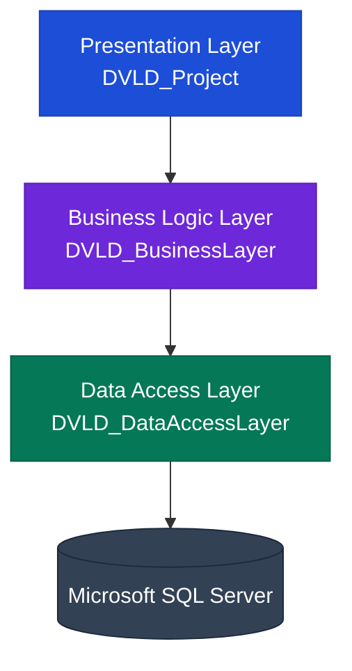

# 🚘 DVLD — Driver & Vehicle Licenses Department

<p align="center">
  <strong>A Comprehensive Driving License Management System</strong>
  <br/>
  A Database-Driven Desktop Application Built with C# and .NET Framework
</p>

<p align="center">
  
  
  
  
</p>

<p align="center">
  
  
  
</p>

---

## 📖 Overview

**DVLD (Driver & Vehicle Licenses Department)** is a comprehensive desktop management system designed to automate and organize driving license department operations.

The application provides an integrated platform for managing people, users, applications, driving tests, drivers, and licenses through a centralized database.

Developed using **C# and Windows Forms**, powered by **Microsoft SQL Server**, and structured using a **3-Tier Architecture** to maintain clean code organization, separation of concerns, and maintainability.

---

## ✨ Key Features

### 🔐 Authentication & User Management
- User authentication and login.
- Session management and logout.
- User profile management.
- Password changing.
- User account administration.

### 👥 People Management
- Add, update, delete, and search people.
- Manage personal information.
- Profile image support.
- Country and nationality management.
- Data filtering and presentation.

### 📋 Application Management
- Local Driving License Applications.
- International Driving License Applications.
- License renewal.
- Lost and damaged license replacement.
- Release detained licenses.
- Application status management.

### 📝 Tests & Appointments
- Vision test management.
- Written test management.
- Practical driving test management.
- Schedule test appointments.
- Record test results.
- Handle retake test applications.

### 🚗 Drivers & Licenses
- Driver registration.
- License issuance.
- License class management.
- Active license tracking.
- International driving licenses.
- Detained license management.

### 🎨 User Interface
- Modern dark-themed dashboard.
- Sidebar navigation.
- Interactive application menus.
- Real-time clock in the footer.
- Reusable Windows Forms controls.
- Consistent interface styling.

---

## 🏛️ System Architecture

The project follows a **3-Tier Architecture**, separating the application into three independent logical layers.



### 1. Presentation Layer — `DVLD_Project`

Responsible for the graphical user interface and user interactions.

- Windows Forms interface.
- Dashboard and navigation.
- Login and authentication screens.
- People and users management.
- Applications and licenses forms.
- Drivers and tests management.
- Global classes and resources.

### 2. Business Logic Layer — `DVLD_BusinessLayer`

Responsible for application entities, business rules, validations, and processing operations.

Main business classes:

- `clsPerson`
- `clsUser`
- `clsApplication`
- `clsApplicationType`
- `clsDriver`
- `clsLicense`
- `clsLicenseClass`
- `clsLocalDrivingLicenseApplication`
- `clsInternationalLicense`
- `clsDetainedLicense`
- `clsTest`
- `clsTestAppointment`
- `clsTestType`
- `clsCountry`

### 3. Data Access Layer — `DVLD_DataAccessLayer`

Responsible for database communication and data persistence using ADO.NET.

Main responsibilities:

- Execute SQL commands.
- Retrieve and update database records.
- Perform CRUD operations.
- Manage database connections.
- Handle data access operations using ADO.NET.

---

## 🗄️ Database Design

The application uses **Microsoft SQL Server** as its relational database management system.

The database is designed around interconnected entities representing the main operations of a driving license department.

**Main Database Entities:**

| Entity | Responsibility |
|:---|:---|
| People | Personal information |
| Users | System accounts |
| Countries | Country information |
| Applications | Application records |
| Application Types | Application classifications |
| Drivers | Registered drivers |
| Licenses | Issued driving licenses |
| License Classes | License categories |
| Detailed Licenses | License details |
| International Licenses | International license records |
| Local Driving License Applications | Local license requests |
| Test Types | Driving test categories |
| Test Appointments | Test scheduling |
| Tests | Test results |

---

## 🧰 Technologies & Tools

| Technology | Usage |
|:---|:---|
| C# | Core programming language |
| .NET Framework | Application framework |
| Windows Forms | Desktop user interface |
| Microsoft SQL Server | Database management |
| ADO.NET | Database connectivity |
| SQL | Database queries and operations |
| Visual Studio | Development environment |
| Git & GitHub | Version control |

---

## 📂 Solution Structure

```text
Driving_Vehicle_License_Department/
│
├── DVLD_BusinessLayer/
│   ├── clsApplication.cs
│   ├── clsApplicationType.cs
│   ├── clsCountry.cs
│   ├── clsDetainedLicense.cs
│   ├── clsDriver.cs
│   ├── clsInternationalLicense.cs
│   ├── clsLicense.cs
│   ├── clsLicenseClass.cs
│   ├── clsLocalDrivingLicenseApplication.cs
│   ├── clsPerson.cs
│   ├── clsTest.cs
│   ├── clsTestAppointment.cs
│   ├── clsTestType.cs
│   └── clsUser.cs
│
├── DVLD_DataAccessLayer/
│   ├── clsApplicationData.cs
│   ├── clsApplicationTypeData.cs
│   ├── clsCountryData.cs
│   ├── clsDataAccessSettings.cs
│   ├── clsDetainedLicenseData.cs
│   ├── clsDriverData.cs
│   ├── clsInternationalLicenseData.cs
│   ├── clsLicenseClassData.cs
│   ├── clsLicenseData.cs
│   ├── clsLocalDrivingLicenseApplicationData.cs
│   ├── clsPersonData.cs
│   ├── clsTestAppointmentData.cs
│   ├── clsTestData.cs
│   ├── clsTestTypeData.cs
│   └── clsUserData.cs
│
├── DVLD_Project/
│   ├── Applications/
│   ├── Drivers/
│   ├── Global Classes/
│   ├── Licenses/
│   ├── Login/
│   ├── Main/
│   ├── People/
│   ├── Resources/
│   ├── Tests/
│   ├── Users/
│   ├── App.config
│   └── Program.cs
│
└── README.md
```

---

## ⚙️ Getting Started

### Prerequisites

Before running the application, make sure you have:

- Microsoft Visual Studio.
- .NET Framework version targeted by the solution.
- Microsoft SQL Server.
- SQL Server Management Studio (SSMS).

### Installation

**1. Clone the Repository**

```bash
git clone YOUR_REPOSITORY_URL
```

**2. Open the Solution**

Open `Driving_Vehicle_License_Department.sln` using Visual Studio.

**3. Configure the Database**

- Create the DVLD database in SQL Server.
- Execute the database creation and initialization scripts.
- Configure the connection string in `App.config`.

**4. Build & Run**

- Restore the required project references if necessary.
- Build the solution.
- Run `DVLD_Project`.

---

## 🎓 Learning Outcomes

Developing this project provided practical experience in:

- Implementing 3-Tier Architecture.
- Applying Separation of Concerns.
- Building database-driven desktop applications.
- Designing relational database schemas.
- Using ADO.NET for data persistence.
- Writing complex SQL queries and joins.
- Managing authentication and application sessions.
- Developing reusable Windows Forms components.
- Handling DataGridView, ContextMenuStrip, timers, and image resources.

---

## 🚀 Future Enhancements

- Advanced role-based access control.
- Comprehensive system activity logs.
- Automated database backup and restore.
- Advanced reporting and analytics.
- Improved database deployment process.

---

## 👨‍💻 Developer

**Amr Tamer**

Backend Developer | C# | .NET | SQL Server

GitHub: [@AmrTamerTech](https://github.com/AmrTamerTech)

---

<p align="center">
  <strong>DVLD — A Complete Solution for Driving License Department Management.</strong>
  <br/>
  <sub>Designed and developed with C# and Microsoft SQL Server.</sub>
</p>
